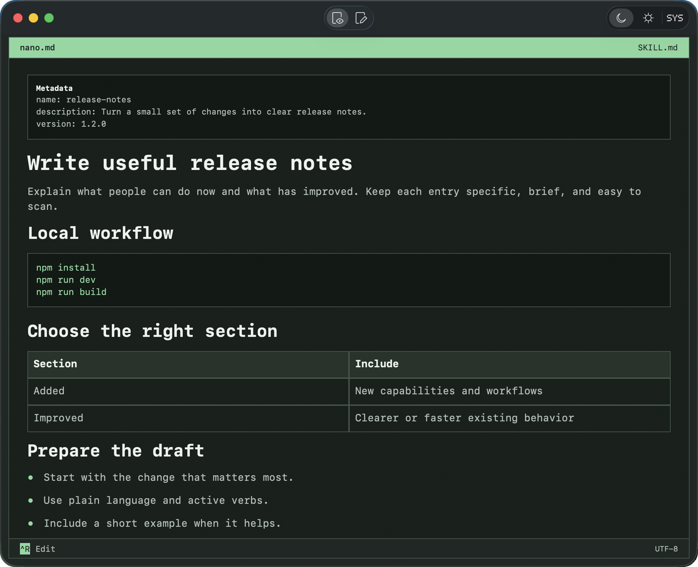

<p align="center">
  
</p>

<h1 align="center">nano.md</h1>

<p align="center">
  A small, free, native Markdown reader and editor for macOS.
</p>

<p align="center">
  <a href="https://github.com/SiavashB/nano.md/releases"></a>
  <a href="LICENSE"></a>
  <a href="https://github.com/SiavashB/nano.md/actions/workflows/ci.yml"></a>
</p>

<p align="center">
  <a href="docs/images/nano-md-dark.png"></a>
</p>

<p align="center">
  <sub>SKILL.md in Nano Dark. The current release replaces the pictured UTF-8 footer label with Feedback.</sub>
</p>

## Download

**[Download nano.md 0.1.0 beta 5 for Apple Silicon](https://github.com/SiavashB/nano.md/releases/download/v0.1.0-beta.5/nano.md-v0.1.0-beta.5-arm64.zip)** · [Release notes and checksum](https://github.com/SiavashB/nano.md/releases/tag/v0.1.0-beta.5) · [Website](https://nano.thirdeyeds.com/)

Build 20 · **2.23 MB ZIP download** · **4.0 MB uncompressed app** (decimal MB).

Unzip and move `NanoMD.app` to Applications. The app is Developer ID signed and notarized; verify the ZIP with the release's `SHA256SUMS.txt`.

Requires Apple Silicon and macOS 15.0 or later. **Beta compatibility:** runtime checks on macOS 15 remain pending; see the [roadmap](docs/ROADMAP.md#2-minimum-os-compatibility).

## Why nano.md

- **Small and native.** Built with SwiftUI and AppKit, with a 4.0 MB app bundle.
- **Read and edit ordinary Markdown.** Open README files, notes, `AGENTS.md`, and `SKILL.md`. Switch between formatted reading and source editing with Control-R.
- **Readable front matter.** Leading YAML metadata appears in a compact panel, while Edit keeps the original text.
- **Local and free.** No account, subscription, or paid tier. The Mac app has no telemetry or network entitlement and does not load remote resources.
- **Your preferred appearance.** Choose Nano Dark, Linen Light, or follow the system setting.

<a id="reading-and-editing"></a>
<a id="appearance"></a>
<a id="markdown-support"></a>

## Using nano.md

Open `.md` or `.markdown` files with Command-O or Finder's **Open With** menu. Existing files start in Read; new documents (Command-N) start in Edit. Saving and undo use the macOS document system.

The reader supports headings, lists, quotes, code blocks, tables, and web links. See the [user guide](docs/USAGE.md) for editing, appearance, file preservation, and the full Markdown support details.

## Current limitations

- Images appear as text placeholders; code blocks have no syntax highlighting.
- CommonMark/GFM support is partial: HTML stays literal, task lists are noninteractive, and relative links, anchors, and non-web URL schemes do not navigate.
- Returning to Read resets reader selection and scroll. Undo/redo requires editor focus.
- Documents over 1 MiB or beyond complexity limits fall back to selectable source.
- Apple Silicon only; no Intel build or Quick Look extension.

Remaining save-error, input-method, external-conflict, and recovery checks are tracked in the [roadmap](docs/ROADMAP.md#1-document-reliability). Use the [bug report form](https://github.com/SiavashB/nano.md/issues/new?template=bug_report.yml) or [Feedback](https://nano.thirdeyeds.com/feedback) for ordinary problems. Report security vulnerabilities [privately](SECURITY.md).

## Build

Requires Xcode 26.6, Swift 6 language mode, and Apple Silicon. Open `NanoMD.xcodeproj`, select the `NanoMD` scheme, and run. For unsigned compilation from the repository root:

```sh
xcodebuild \
  -project NanoMD.xcodeproj \
  -scheme NanoMD \
  -configuration Debug \
  -destination 'platform=macOS,arch=arm64' \
  -derivedDataPath "$PWD/Temp/DerivedData" \
  -clonedSourcePackagesDirPath "$PWD/Temp/SourcePackages" \
  -packageCachePath "$PWD/Temp/PackageCache" \
  -onlyUsePackageVersionsFromResolvedFile \
  ARCHS=arm64 CODE_SIGNING_ALLOWED=NO \
  build
```

CI compiles Debug and Release; there are no automated test targets. Compilation does not verify signing, functionality, or runtime compatibility. See [Contributing](CONTRIBUTING.md) for signing, validation, and app-size measurements.

## Project documentation

- [User guide](docs/USAGE.md)
- [Contributing](CONTRIBUTING.md)
- [Architecture](docs/ARCHITECTURE.md)
- [Roadmap](docs/ROADMAP.md)
- [Releasing](docs/RELEASING.md)
- [Website](website/README.md)

## License

[MIT](LICENSE). The app bundles its license and [third-party notices](NanoMD/Resources/ThirdPartyNotices.txt).
